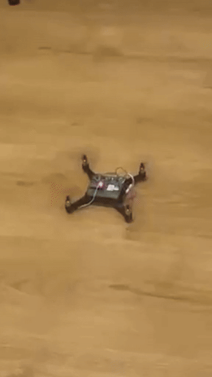
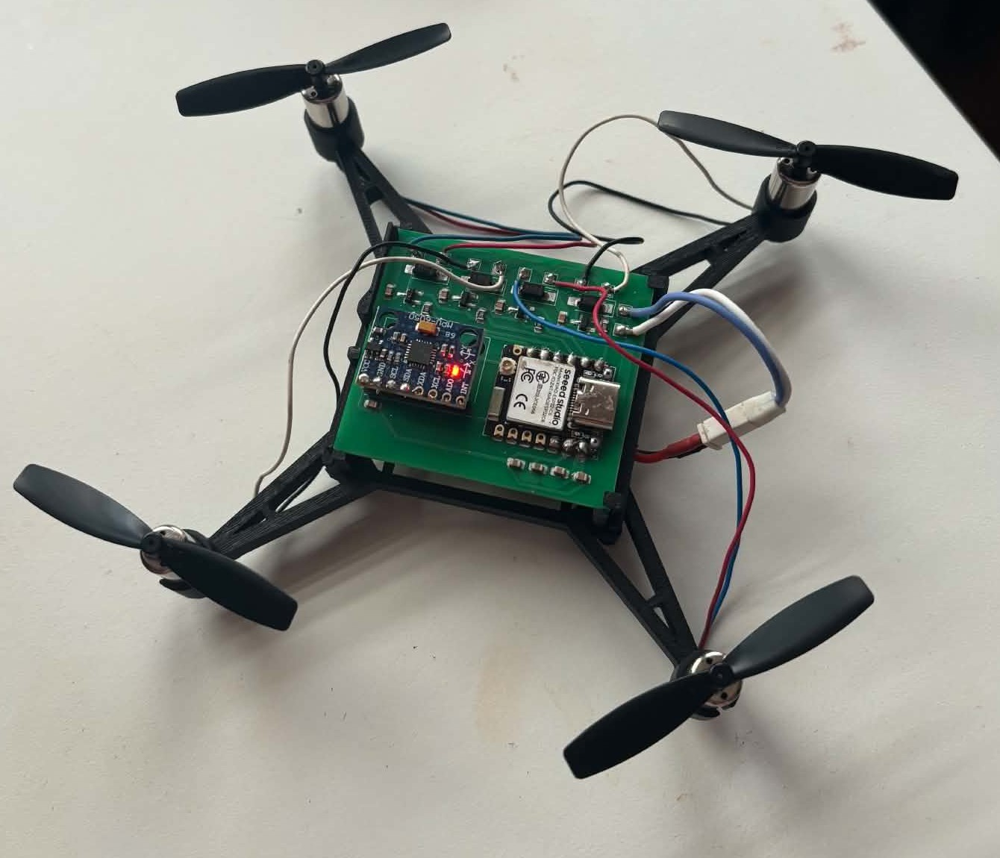
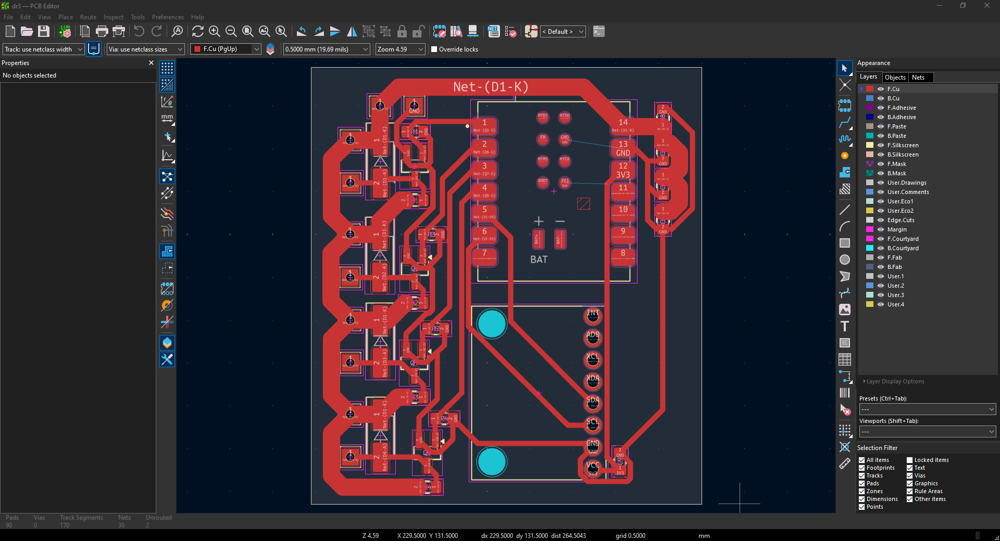
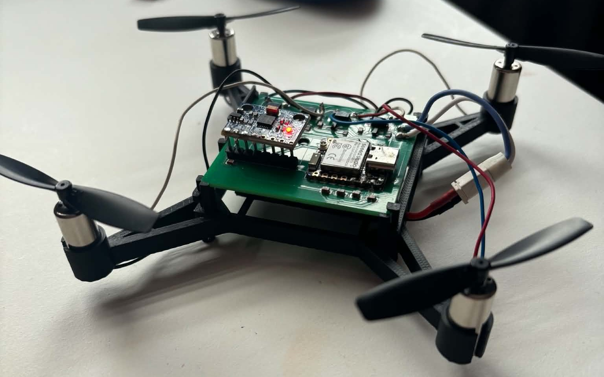

# DR3 – micro quadcopter with a custom flight controller

A micro quadcopter I designed and built from scratch: my own flight controller PCB designed in KiCad,
flight firmware for the Seeed XIAO ESP32-C6, and a hand-held ESP32 remote linked over ESP-NOW.

<p align="center">
  
  
</p>

**Tech:** KiCad · 2-layer PCB design · C++ · ESP32 / ESP32-C6 · ESP-NOW · MPU6050 over I²C ·
sensor fusion · cascaded PID control

## System overview

| Part | Hardware | Role |
|---|---|---|
| Drone | Custom PCB: Seeed XIAO ESP32-C6, MPU6050 IMU, 4 MOSFET motor channels | Attitude estimation, cascaded PID control, motor PWM, arming logic |
| Remote | ESP32 Dev Module, 2 analog joysticks with ARM / KILL buttons | Reads the sticks and sends control frames over ESP-NOW |

## Hardware – controller PCB



- 2-layer PCB, approx. 45.5 × 51 mm, designed in KiCad (schematic, layout, Gerber files)
- 4 motor channels, each with an N-MOSFET (SOT-23) and an SS14 diode
- Seeed XIAO ESP32-C6 module and MPU6050 (GY-521) IMU over I²C
- 0805 / SOT-23 / SMA footprints; design and production files in [`dr3/`](dr3)



## Firmware

One Arduino sketch for both boards in [`firmware/dr3/`](firmware/dr3). The role is chosen automatically
from the selected board: **XIAO_ESP32C6 → drone**, **ESP32 Dev Module → remote**.

- **Attitude estimation:** gyro and accelerometer fusion in the FRD body frame
- **Control:** angle P loop → angular-rate PID (filtered derivative on measurement, anti-windup), X-frame mixer
- **Arming and stop conditions:** state machine (locked / disarmed / armed / fault); arming only at zero
  throttle with centred sticks; motors stop on KILL, link loss, IMU fault, excessive tilt or USB connection
- **Radio:** ESP-NOW control frames with a project ID and sequence numbers; the drone accepts frames only
  from the first remote it hears and only newer than the previous one
- **Calibration at power-up:** the remote averages the stick centres, the drone averages 200 gyro samples
  to obtain the gyro bias
- **Status LED:** fault, armed, ready to arm, waiting

## Technical details

Built with Arduino-ESP32 3.3.x. Pins, radio settings, IMU mounting and controller gains are in
[`config.h`](firmware/dr3/config.h).

```
firmware/dr3/   drone and remote firmware (C++)
dr3/            KiCad project and Gerber files
docs/images/    photos, flight GIF and the KiCad screenshot
```
